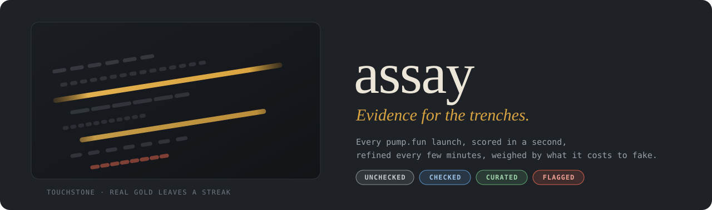
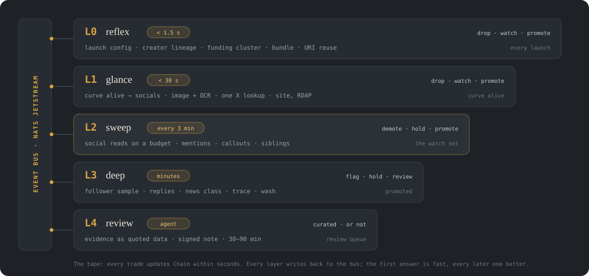
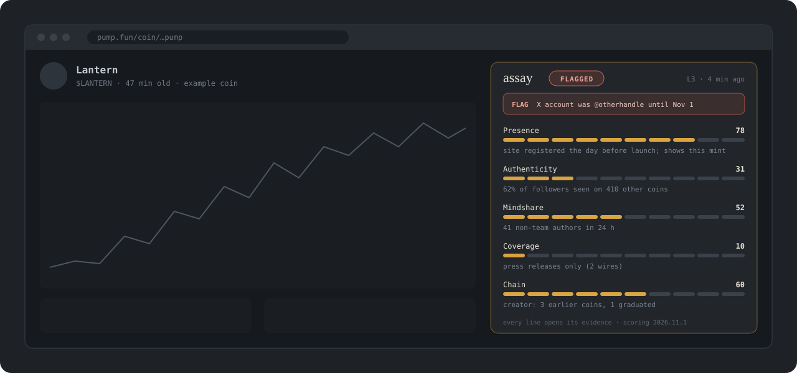

<p align="center">
  
</p>

<p align="center">
  
  
  
  
  
  
  
  
  
  <a href="https://t.me/assayoffice"></a>
  
  <a href="docs/verified.md"></a>
</p>

<p align="center">
  <b>Curation scoring for pump.fun coins, from the first second.</b><br>
  Social presence, how real it is, mindshare, news and the chain, measured as evidence<br>
  and served to your agent, a Telegram channel and the pump.fun page itself.
</p>

<p align="center">
  <a href="#how-it-works">How it works</a> ·
  <a href="#the-rule">The rule</a> ·
  <a href="#what-you-get">What you get</a> ·
  <a href="#lenses">Lenses</a> ·
  <a href="#pure-launches">Pure launches</a> ·
  <a href="#launch-kit">Launch kit</a> ·
  <a href="#for-agents">For agents</a> ·
  <a href="#run-your-own">Run your own</a> ·
  <a href="#roadmap">Roadmap</a> ·
  <a href="#docs">Docs</a>
</p>

---

> [!NOTE]
> **This repo is the design. There's no code yet.** It's published so the design can be read, argued with and built
> against. The [roadmap](#roadmap) says what lands first.

## Why

Most pump.fun coins list an X account, a Telegram and a website, with nothing behind them. The few that have something
behind them are hard to tell apart from the many with bought followers, a templated site and a paid press release, and
the difference has to be found in minutes, because that's how long a coin in the trenches stays relevant.

assay is a baseline for finding it: an open, forkable scoring system that an agent can listen to, a person can read,
and anyone can change.

## How it works

<p align="center">
  
</p>

Every launch goes onto an **event bus**. Five layers listen to it, and each one answers faster than the next:

- **L0 reflex** scores a coin within a second of its create transaction, from the chain and memory alone: how it was
  launched, who created it, what else they've launched, where their SOL came from, whether the launch was bundled,
  whether its metadata is a reused upload.
- **L1 glance** runs once the coin's curve comes alive, within 30 seconds. Is the image a copy (hashes, embeddings,
  OCR)? Does the X account exist, and has it always been this account? Was the website registered yesterday? Does it
  show the right mint?
- **The tape** reads every trade as it lands and keeps the chain picture current within seconds: who just entered,
  whether the bundle or the dev is selling, where the fees went.
- **L2 sweep** is a loop for the reads that cost money. Every few minutes it works through the watch set, ranked by
  activity and staleness, and checks as many coins' socials as its budget allows: new mentions, callouts, engagement,
  rival versions. More budget means more coins and fresher data.
- **L3 deep** spends real money on the coins that earn it: follower samples, reply clustering, mindshare net of the
  team, news sorted by whether the outlet sells placement, full funding traces, wash detection.
- **L4 review** is an agent that reads the evidence, as data, and decides whether a coin is `curated`, typically 30–90
  minutes in. It writes a note signed with its exact model. It can't promote past a failed gate, and it can't clear a
  flag.

**Push, never poll.** Launches arrive over Yellowstone gRPC and an RPC websocket at `processed` commitment, decoded
straight from pump.fun's program logs; curves are watched with account subscriptions, and creator wallets, fee vaults
and known clusters with RPC address webhooks. No layer waits for the next one. A consumer that needs an answer in a second takes L0's, along with its confidence; a
consumer that can wait listens for the next score. [Architecture →](docs/architecture.md)

## The rule

**Weigh every signal by what it costs to fake.**

| cheap to fake | expensive to fake |
|---|---|
| 10,000 followers | a 2019 X account that has only ever had one handle |
| 500 replies saying "LFG" | 200 distinct authors with histories of *not* posting every coin |
| a press release on a newswire | a story by a named reporter at an outlet that doesn't sell placement |
| a thousand holders | a thousand holders funded from a thousand different places |
| a slick website | a domain with a Wayback history from before the coin existed |

Whatever looks predictive this month gets gamed next month. What's expensive to fake stays expensive. That's why the
weights are public: the only way to move the score is to do the expensive, real thing. [Signals →](docs/signals.md) ·
[How it gets gamed →](docs/adversarial.md)

## What you get

Every coin gets a **tier** and five **dimensions**, each with a confidence and the evidence behind it.

<p>
  
  
  
  
</p>

| dimension | asks |
|---|---|
| **Presence** | Does anything exist off-chain? X, Telegram, a website, GitHub, Farcaster |
| **Authenticity** | Is that presence real? Follower quality, overlap with known farms, reply patterns, renamed accounts |
| **Mindshare** | Are people outside the team talking about it, on-chain, on Farcaster, Telegram, Reddit and X, weighted by how hard each source is to fake? |
| **Coverage** | Has anyone credible written about it, or is it press releases only? |
| **Chain** | The creator's history, funding sources, launch bundles, holder diversity, wash trading |

The unit underneath is the **observation**: a dated, sourced fact with a pointer to what it was read from. Scores are
built from observations and always link back to them.

> *The linked X account (created 2021-03-09) was @otherhandle until 2026-11-01.*
> `x.handle_history` · cost to fake: high · L1 · observed 2026-11-03T09:05Z

Two kinds of warning, kept apart. **Integrity flags** are facts everyone is shown first: the wrong mint on the site,
a celebrity link the celebrity never made, a renamed account, deleted promises, a fee-sharing promise the config
doesn't keep, text written to manipulate an AI reviewer. **Risk traits** (bundled, sniped, a serial creator, a
predatory wallet entering, a copied image or ticker, a caller with a bad history) are descriptions, and what they mean
depends on who's reading. [Scoring →](docs/scoring.md)

assay never says buy, sell, or what a coin is worth. It says what's there.

## Lenses

The same facts read differently depending on who's trading. A heavily bundled coin is a warning to someone holding for
a week and the whole point to someone scalping its volatility. So assay keeps the facts the same for everyone and lets
**lenses** do the interpreting:

| lens | reads the coin as |
|---|---|
| **curator** (default, sets the tier) | is there something real here? |
| **volatility** | bundles, snipers and a thin book: price action, and the reason for it |
| **runner** | a meme with the basics, the pairing the market prefers right now, and someone with reach involved |
| **clean book** | no predatory wallets, a small and sold-down bundle, no caller with a front-running history |
| **beta** | the copies and siblings of a coin that's already running |
| **original** | only the first of a narrative |
| **pure** | honest structure at launch, nothing about quality: what the Telegram channel posts |

A lens is a short YAML file. Writing your own is the expected way to use assay. Lenses other than the curator can also
read **outcome history**: what coins with the same traits did before, with the sample size. That's history about other
coins, never a prediction about this one. [Lenses →](docs/lenses.md)

## Pure launches

**[Assay Office](https://t.me/assayoffice)**, the Telegram channel, doesn't post good coins. It posts **pure launches**: coins whose structure is honest at launch,
decided within seconds, with **no market details** at all. No price, no market cap, no volume, no holder count. If you
want those, go and look, and do your own research while you're there.

```
PURE LAUNCH  $TICKER  Name
<mint>

Dev bought 2.1% in the create transaction, nothing since.
No bundle. No known bundler or predator wallets among the first buyers.
Creator's first launch, funded from an exchange.
Original image and metadata.
The site and X account show this mint.

Pure as of 0:34 after launch. Not a recommendation: do your own research.
```

Pure means: a small dev buy and nothing hidden, no bundle, no known bad wallets early, a creator with a clean history,
an original image and metadata, links that show this mint, and a fee setup that matches what it promises. A coin with
no socials can still be pure.

Pure launches often die in the first five minutes because a bundle buys in *after* launch and dumps on whoever
arrived. So a posted coin is watched for 15 minutes. The tape clusters late buyers by funding, by when they were
funded, by slot and amount, and if a group crosses the line the post is **edited in place within seconds**: *"No longer
pure at 2:14: 9 wallets funded within 3 minutes of each other bought 31% of supply."* A coin that gets through says so:
*"Still pure at 5:00."*

Each post carries a **thread** of the coin's history as it happens:

```
└ 0:34  Pure: every check passed.
└ 1:02  Late bundle: 9 wallets funded within 3 minutes of each other bought 31% of supply. No longer pure.
└ 1:30  Up 14× since launch, and it isn't demand: 0.8% of the buying since 0:34 came from independent wallets.
└ 3:10  The bundle is selling: 60% of its position in 40 seconds.
└ 15:00 Watch ended. 41 independent buyers since launch. The bundle has sold 100% of its position.
```

A price move appears only next to what made it, and only when what made it isn't demand: it's there to say the chart
is fake, never that it's going up. [Pure launches →](docs/pure.md)

## Launch kit

For creators who want a pure launch: the checklist, and a **preflight** that runs it before the coin exists.

```sh
npx @assay/preflight plan.json
```
```
PASS  dev wallet: funded from an exchange 9 days ago, no earlier launches
PASS  dev buy: 0.5 SOL ≈ 1.8% of supply at launch
FAIL  image: perceptual match (distance 3) with $LANTRN, launched 2 days ago
FAIL  website: does not show the mint yet; add <mint> to the page
WAIT  alive: decided after launch
```

A passing plan can be **declared**, keyed by the mint's public key, so the launch is checked against it in seconds.
Free, read-only, public keys only, and it never buys a post. [Launch kit →](docs/launch-kit.md)

## What assay looks for that the chain doesn't say out loud

| | |
|---|---|
| **predatory wallets** | funding clusters that enter after launch, take a large share and exit into the buyers they draw. Classed by their history across every pump coin, and caught entering within seconds |
| **callouts** | a call by an influencer can mark a top. assay records every call against the caller's history and tests five explanations for why (exit liquidity, paid because demand was missing, late, front-run by bots, a few good callers hidden by many bad ones). assay's own channel gets the same treatment |
| **category** | a tech coin won't run like a meme with an influencer behind it. Each coin is judged against its own category, and "tech" stays "tech (claimed)" until a product backs it |
| **pairing and rewards** | coins that don't share rewards or aren't on the quote the market prefers get passed over for a version that does. assay reads the fee and sharing config, checks it against what the creator actually did, and compares it with what the market is choosing this week |
| **vamps** | copied tickers and images, caught with metadata reuse, perceptual hashes, image embeddings, OCR on text in the image, and reverse image search for art lifted from the web; reported with both the first and the largest earlier coin |

Every one starts as a [hypothesis](docs/hypotheses.md) with a test, and becomes a trait only when assay's own data backs it.

## Where it shows up

<p align="center">
  
</p>

| surface | |
|---|---|
| **pump.fun overlay** | a browser extension: a badge on every coin card, the evidence panel on every coin page. No wallet access, ever. |
| **Telegram channel** | pure launches, within seconds, with no market details; edited in place if purity breaks |
| **free demo** | assay.meex.work: the live tape of launches and decisions, a page per coin, the sweep's real stats |
| **your agent** | the bus, the API, or the MCP server |

[Overlay, demo and channel →](docs/overlay.md)

## For agents

Three ways in, from fastest to simplest.

**Subscribe to the bus.** Every observation, score, flag and tier change as it happens, with replay from any point in
time.

```ts
const sub = await js.subscribe("assay.tier", { config: { durable_name: "my-agent" } });
for await (const m of sub) { const e = m.json(); if (e.data.to === "curated") consider(e.mint); m.ack(); }
```

**Call the API.** One coin, a batch of 100, a feed, a stream. `as_of` returns what assay knew at any past moment, so a
backtest never sees the future.

```sh
curl https://assay.meex.work/v1/coins/<mint>?format=brief
```
```
LANTERN · FLAGGED · L3 · 47 min
Presence 78 · Authenticity 31 · Mindshare 52 · Coverage 10 · Chain 60
⚑ X account was @otherhandle until 2026-11-01
62% of a follower sample also follows 410 other coin accounts.
41 non-team authors in 24 h. Press releases only.
```

**Plug in the MCP server.** `assay_lookup`, `assay_batch`, `assay_feed`, `assay_explain`, which returns the evidence as
sentences your agent can quote.

The intended use in a trading harness is a **gate**, not a signal: pick a lens (or write one) and only look at coins
that pass it. `?lens=volatility` on the API, `assay.lens.volatility` on the bus. [API →](docs/api.md) · [Events →](docs/events.md)

## Run your own

```sh
npm install && npm run idl            # dependencies, and pump.fun's IDL at the pinned commit
ASSAY_POST=0 npm run silent           # the silent run, printing posts instead of sending them
npm run report -- --posts             # what it saw: launches, gaps, checks, posts, breaks, edit latency
```

assay is a baseline. Clone it, point your agent at it, change the weights, add signals, drop the ones you don't trust.

You bring the keys; none ship with the repo:

| key | turns on |
|---|---|
| `SOLANA_RPC_URL` + `SOLANA_GRPC_URL` or `SOLANA_WS_URL` | the launch stream, L0, the Chain dimension |
| `X_BEARER_TOKEN` | identity checks on linked X accounts, X's capped share of Mindshare (first-party X API; optional) |
| `MODEL_API_KEY` | classification, extraction, the L4 review agent |
| `NEWS_API_KEY` | Coverage |
| `TELEGRAM_BOT_TOKEN` · `NEYNAR_API_KEY` | Telegram counts and the channel · Farcaster |

X is optional. It's one mindshare source among several, the most manipulated one, and weighted that way; assay never
spends an X read on a coin until the chain says it's alive, and works with no X key at all.

A missing key switches its signals off and lowers confidence. A run without X data never passes itself off as one
with it. Every weight, threshold and budget lives in one file, `config/weights.yaml`. [Costs →](docs/costs.md)

## Roadmap

- [x] Design: signals, scoring, layers, bus, API, retention, overlay
- [x] Assumptions reviewed adversarially; findings in [assumptions](docs/assumptions.md)
- [x] Verify the launch mechanics against the IDL and real launches ([verified](docs/verified.md))
- [x] **Silent run** ([src/](src), running since 2026-11-04): both feeds reconciled, L0 + the tape, the pure checklist
      (chain, metadata, links), Assay Office posts with edits and threads, a held-out control set, `npm run report`
- [ ] `bus` + `ingest` as separate packages: NATS, more than one process
- [ ] **Backfill**: every historical launch, creator, image and early-buyer funding cluster
- [ ] Wallet reputation beyond dispersers: predators, snipers, the entry ledger
- [ ] Week-one measurement: launch rate, L1 pass rate, X reads per coin → real numbers in [costs](docs/costs.md)
- [ ] **L1 glance** + the API + `?format=brief`
- [ ] **L2 sweep loop** with window budgets and `assay.sweep` stats
- [ ] **L3 deep** + **L4 review agent**
- [ ] **Pure launches**: the checklist, late-bundle detection, the Telegram channel, edit-on-break, the measured bot and bundle effect
- [ ] **Launch kit**: preflight CLI + API, declared launches
- [ ] Lenses: the evaluator, the seven built-ins, `?lens=`
- [ ] Hypothesis tests H1–H6 on the first month of data
- [ ] MCP server, Telegram channel, free demo at assay.meex.work
- [ ] pump.fun overlay (userscript first, then the store extension)
- [ ] More launchpads

## Docs

| | |
|---|---|
| [architecture](docs/architecture.md) | speed (streams, logs, webhooks), the bus, the five layers, the tape, the sweep loop, the indexes, keys |
| [events](docs/events.md) | topics, envelope, examples, subscribing and replay |
| [signals](docs/signals.md) | every signal, its source, what it costs to fake |
| [scoring](docs/scoring.md) | observations → dimensions → tiers; integrity flags and risk traits; calibration |
| [lenses](docs/lenses.md) | the same facts read for different risk profiles; writing your own |
| [pure launches](docs/pure.md) | the checklist, late bundles, the Telegram post, edit-on-break, the trade-offs |
| [launch kit](docs/launch-kit.md) | the creators' checklist, preflight, declared launches |
| [hypotheses](docs/hypotheses.md) | trench beliefs (bundles, predators, callouts, category, pairing, vamps) and the test for each |
| [assumptions](docs/assumptions.md) | every load-bearing assumption, its verdict, and what changed |
| [verified](docs/verified.md) | the plan's pump.fun claims checked against the IDL and ~41,500 real launches |
| [api](docs/api.md) | REST, batch, stream, webhooks, MCP, point-in-time |
| [retention](docs/retention.md) | what's kept, for how long, and what each platform's terms allow |
| [overlay](docs/overlay.md) | the extension, the demo, the Telegram channel |
| [adversarial](docs/adversarial.md) | every way it gets gamed, and the counter |
| [costs](docs/costs.md) | providers, cost per layer, how to measure it |
| [decisions](docs/open-questions.md) | what's settled and what's still open |
| [schema](schema/report.v1.json) · [example](examples/report.example.json) | the report as JSON Schema, and a filled-in fictional coin |

## Principles

- **Evidence, not verdicts.** Every number links to the facts behind it. Facts say "this creator launched 14 coins in
  30 days", never "scam".
- **Read-only.** No contracts, no transactions, no wallets, no keys of yours beyond the API keys you choose to give
  your own instance.
- **Facts for everyone, readings for each.** Observations and traits are the same for every reader; lenses interpret.
- **Calibrated on behaviour, not price.** The curator's weights are tuned against what the dev, the bundle and the
  holders actually did. "Went up" isn't a quality.
- **Nothing rewritten.** Corrections add a new observation; the old one stays on the record.

## Brand

The mark is a hallmark: the stamp an assay office strikes on metal that passes. [brand/logo.png](brand/logo.png)
(1024², the PNG is canonical; the SVG sets its letter in Georgia), and the records mark for the discussion group,
[brand/records.png](brand/records.png): the same stamp holding a log, on bone · palette touchstone `#1A1D22`, gold `#D9A441`,
bone `#ECE6D8`.

## License

[MIT](LICENSE) © 2026 SHYGUY LLC
