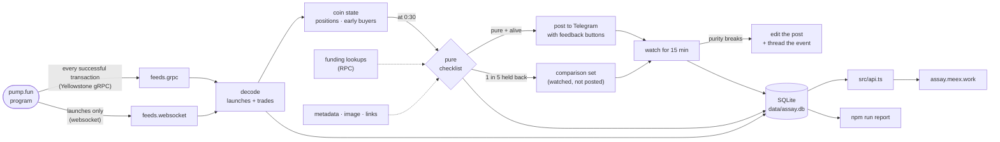
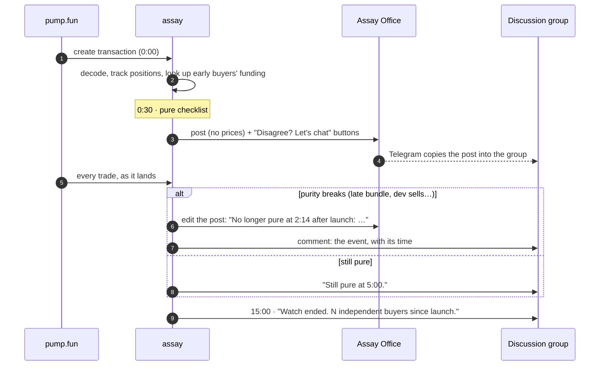
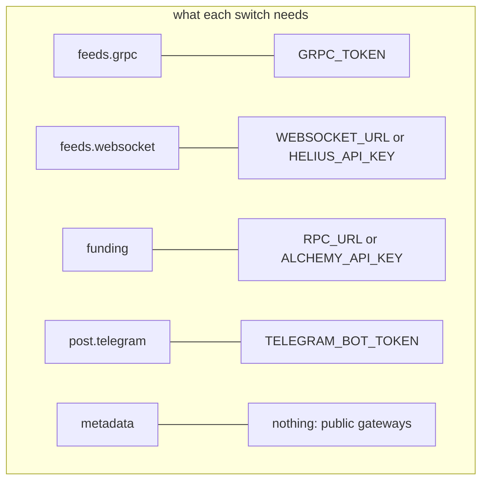
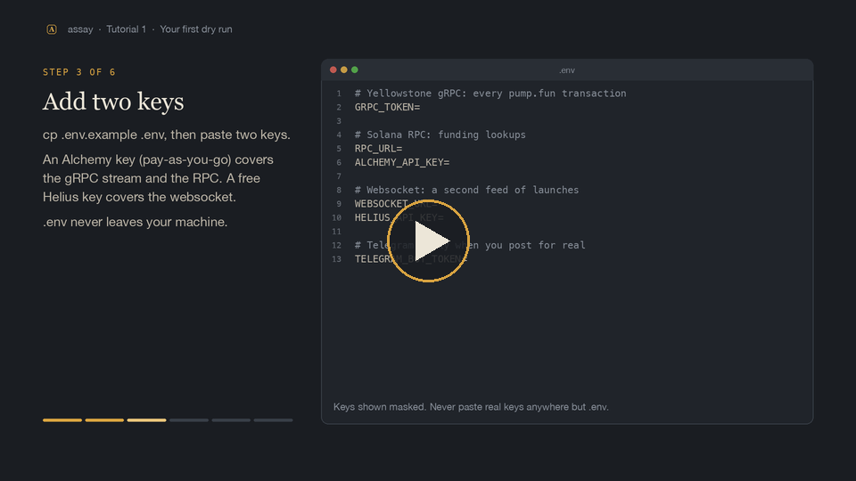

<p align="center">
  
</p>

<p align="center">
  
  
  
  
  
  
  
  <a href="docs/verified.md"></a>
  <a href="https://t.me/assayoffice"></a>
  <a href="https://assay.meex.work"></a>
</p>

<p align="center">
  <b>Curation for pump.fun coins, from the first second.</b><br>
  Every launch is checked thirty seconds in. The ones whose structure is honest are posted,<br>
  watched for fifteen minutes, and edited the moment that stops being true. No prices, ever.
</p>

<p align="center">
  <a href="#quick-start">Quick start</a> ·
  <a href="#how-it-works">How it works</a> ·
  <a href="#modules-and-switches">Modules and switches</a> ·
  <a href="#tutorials">Tutorials</a> ·
  <a href="#what-you-see">What you see</a> ·
  <a href="#the-full-design">The full design</a> ·
  <a href="#docs">Docs</a>
</p>

---

> [!NOTE]
> **What's running and what's designed.** The [silent run](#how-it-works) (both feeds, the pure checklist, posting to
> [Assay Office](https://t.me/assayoffice), the 15-minute watch, the [live site](https://assay.meex.work)) is built and
> running. The [pump.fun overlay](https://assay.meex.work/overlay) (a userscript) is built too. Everything under
> [The full design](#the-full-design) (the event bus, layers L1–L4, lenses, the agent API, the launch kit) is a written
> design that isn't built yet. Each section says which it is.

## Quick start

You need **Node.js 22.18 or newer** and **git**. Everything below runs in **dry mode**: it watches pump.fun live and
prints what it would post, without posting anything.

```sh
git clone https://github.com/meex-works/assay.git
cd assay
npm install                 # dependencies
npm run idl                 # downloads pump.fun's program interface (pinned)
cp .env.example .env        # then fill in your keys: see docs/tutorials/02-keys.md
npm run doctor              # checks every key and provider, tells you exactly what's missing
npm run silent -- --dry     # runs: prints each pure launch instead of posting it
```

In another terminal, while it runs:

```sh
npm run report -- --posts   # what it has seen so far: launches, verdicts, posts, breaks, edit speed
```

New to this? Start with **[Tutorial 1: your first dry run](docs/tutorials/01-quickstart.md)**. It explains every step.

## How it works

*This is what runs today.*



1. **Two feeds see every launch.** A Yellowstone gRPC stream carries every successful pump.fun transaction (launches
   and trades). A websocket carries launches only, as an independent second source; any launch only one of them saw
   is logged as a gap. On mainnet the two agree on 99.8% of launches and gRPC is ahead by about 120 ms.
2. **Each transaction is decoded** into launches and trades. pump.fun emits its events as inner instructions and in the
   logs; assay reads the inner instructions first, because logs get truncated on 0.3% of trades
   ([verified](docs/verified.md)).
3. **Each coin's first minutes are tracked in memory:** every wallet's net position, who bought in the first minute,
   and (once a coin has three outside buyers) where each early buyer's SOL came from.
4. **At 0:30 the pure checklist runs** ([details](docs/pure.md)): a small dev buy the dev still holds, no bundle among
   the first buyers, no wallets from known dispersers, not a serial creator, an original image and metadata, links
   that exist, and a fee setup that matches what the description promises. pump.fun's own mayhem agent is known by
   address and never counts against a coin.
5. **Pure and alive coins are posted** to Telegram with no market details, unless the coin falls in the one-in-five
   comparison set, which is watched identically but never posted.
6. **The watch runs for 15 minutes.** Every trade is checked: a late bundle, the dev selling, a bundle selling, a move
   that isn't demand. When purity breaks, the post is edited in place (about 0.4 s after the trade that broke it) and
   the event goes into the coin's comment thread.
7. **Everything is written to SQLite** for the week's analysis, and served read-only to the
   [live site](https://assay.meex.work).

### One coin's life



## Modules and switches

Every module can be turned off. Settings live in [`config/assay.yaml`](config/assay.yaml); any of them can be
overridden for one run without editing the file:

```sh
npm run silent -- --dry                                  # print instead of posting
npm run silent -- --set feeds.websocket=false            # one setting, this run only
ASSAY_FUNDING=false npm run silent                       # the same, as an environment variable
npm run silent -- --config config/my-instance.yaml       # a whole other config file
```



| switch | default | what it does | when it's off |
|---|---|---|---|
| `feeds.grpc` | on | every successful pump.fun transaction: launches and trades | launches only; every coin reads as dead at 0:30 |
| `feeds.websocket` | on | a second, independent source of launches | no cross-check between feeds |
| `funding` | on | one-hop funding lookups for early buyers | cheaper; bundles funded from different wallets are only caught when they buy in the launch's first slots |
| `metadata` | on | fetch metadata, image and links | originality rests on the on-chain metadata URI and name/ticker; no link checks |
| `checks.<name>` | on | each rule of the checklist, separately | that rule is skipped, never counted as failed |
| `post.telegram` | on | post pure launches to `post.channel` | judge and watch only: the database and site still fill |
| `post.dry` | off | print posts, edits and comments instead of sending them | — |
| `post.control_share` | 0.2 | the share of pure coins held back as the comparison set | `0` posts every pure coin |
| `watch` | on | the 15-minute watch, edits and threads | post once, never edit |
| `feedback.*` | on | "Disagree with a rule or finding? Let's chat" buttons under posts and on the site | empty links remove the buttons |

The checklist's thresholds (the 5% dev buy, the 30 s posting time, the 15 min watch, the late-bundle share) live in
[`config/lenses/pure.yaml`](config/lenses/pure.yaml). Every setting is explained in
[Tutorial 4](docs/tutorials/04-configuration.md).

### Keys

You bring your own; none ship with the repo. They go in `.env` (git-ignored), and `npm run doctor` checks each one
against its provider. You only need keys for what you switch on.

| key | for | where to get it |
|---|---|---|
| `GRPC_TOKEN` (or `ALCHEMY_API_KEY`) | `feeds.grpc` | a Yellowstone gRPC provider: Alchemy, Triton, Chainstack, Helius… ([Tutorial 2](docs/tutorials/02-keys.md)) |
| `WEBSOCKET_URL` (or `HELIUS_API_KEY`) | `feeds.websocket` | any Solana websocket; Helius's free plan is enough |
| `RPC_URL` (or `ALCHEMY_API_KEY`) | `funding` | any Solana RPC |
| `TELEGRAM_BOT_TOKEN` | `post.telegram` | @BotFather ([Tutorial 3](docs/tutorials/03-telegram.md)) |
| `ASSAY_API_KEY` | the site's API | any long random string |

What it costs to run (measured): about 1.1 TB a month of gRPC data (~$85 on Alchemy at $75/TB), free tiers for the
rest. [Costs →](docs/costs.md)

## Tutorials

Step by step, in order. Each one ends with a check that it worked.

| | | | video |
|---|---|---|---|
| 1 | [Your first dry run](docs/tutorials/01-quickstart.md) | install, keys, doctor, watch it judge live launches without posting | [▶ 1:12](https://assay.meex.work/tutorials/01-quickstart.mp4) |
| 2 | [Getting the keys](docs/tutorials/02-keys.md) | gRPC, RPC and websocket providers, what each costs, how to test them | |
| 3 | [Your Telegram channel](docs/tutorials/03-telegram.md) | the bot, the channel, the discussion group, admin rights, the first real post | [▶ 1:18](https://assay.meex.work/tutorials/03-telegram.mp4) |
| 4 | [Configuration](docs/tutorials/04-configuration.md) | every switch and threshold, overrides, and recipes for common setups | |
| 5 | [Running it on a server](docs/tutorials/05-server.md) | a Linux box, systemd services, logs, updates, backups | [▶ 1:15](https://assay.meex.work/tutorials/05-server.mp4) |
| 6 | [The website](docs/tutorials/06-website.md) | the read-only API, a Cloudflare tunnel and Worker, your own domain | [▶ 1:27](https://assay.meex.work/tutorials/06-website.mp4) |
| 7 | [Operating it](docs/tutorials/07-operating.md) | the report, reading the numbers, the database, troubleshooting | |

[](https://assay.meex.work/tutorials/01-quickstart.mp4)

All four walkthroughs on one page: **[assay.meex.work/tutorials](https://assay.meex.work/tutorials)**.

## What you see

**[Assay Office](https://t.me/assayoffice)** on Telegram posts pure launches, never prices:

```
PURE LAUNCH  $Democats  Democats
2PpvTLa4mLUvCQToQXSYJk13FY5z72hGVhpWfEy6pump

No dev buy.
No bundle among the first buyers.
No known bundler or disperser wallets among the first buyers.
No other launch by this creator in assay's record.
Creator wallet first active a minute before launch.
No earlier coin with this image, metadata, or name and ticker.
X account linked.
Holder rewards on.

Pure as of 0:30 after launch. Watched for 15 minutes; this message updates if that changes.
Not a recommendation. Do your own research.
Disagree with a rule or finding? Let's chat
[ Chat on X ]  [ Chat on Telegram ]
```

When purity breaks, the post is edited in place and the event lands in the coin's thread:

```
0:32  Dev sold their whole buy.
2:14  Late bundle: 9 wallets funded within 3 minutes of each other bought 31% of supply.
15:30 Watch ended. 41 independent buyers since launch.
```

A price move appears only next to what made it, and only when what made it isn't demand ("Up 14× since launch. 0.8%
of the buying since 0:30 came from independent wallets."). It says the chart is fake, never that it's going up.

**[assay.meex.work](https://assay.meex.work)** shows the same thing live: the last 24 hours' numbers, every post, why
coins fail, the tape of every coin judged, and a page per coin with its checklist, the post as sent, and its timeline.

## The full design

*Written, reviewed and partly verified on mainnet; not built yet unless it says so.*

The silent run is the first slice of a larger system: curation that weighs every signal by **what it costs to fake**,
across the chain, social presence, mindshare and news, served to agents, a Telegram channel and the pump.fun page
itself.

<p align="center">
  
</p>

| piece | status | doc |
|---|---|---|
| L0 reflex + the tape (chain-only checks in seconds) | **running** (as the silent run) | [architecture](docs/architecture.md) |
| the pure checklist, the watch, the thread | **running** | [pure launches](docs/pure.md) |
| an event bus (NATS) and separate processes per layer | designed | [architecture](docs/architecture.md) · [events](docs/events.md) |
| L1 glance (social identity checks), L2 sweep, L3 deep, L4 review agent | designed | [architecture](docs/architecture.md) |
| five dimensions, integrity flags and risk traits | designed | [scoring](docs/scoring.md) · [signals](docs/signals.md) |
| lenses: the same facts read for different risk profiles | designed (lens files exist) | [lenses](docs/lenses.md) |
| wallet reputation: predators, dispersers, snipers | dispersers + the mayhem agent running; the rest designed | [signals](docs/signals.md#6-wallet-reputation) |
| the agent API, MCP server, point-in-time queries | designed | [api](docs/api.md) |
| the pump.fun overlay | **userscript running** ([install](https://assay.meex.work/overlay)); browser extension designed | [overlay](overlay/) · [design](docs/overlay.md) |
| the launch kit for creators | designed | [launch kit](docs/launch-kit.md) |

**The rule behind all of it:** weigh every signal by what it costs to fake. Ten thousand followers are cheap; a
2019 X account that has only ever had one handle isn't. A thousand holders are cheap; a thousand holders funded from a
thousand different places aren't. Whatever looks predictive this month gets gamed next month; what's expensive to fake
stays expensive. [Signals →](docs/signals.md) · [How it gets gamed →](docs/adversarial.md)

## Docs

| | |
|---|---|
| [tutorials](docs/tutorials/) | setup and operation, step by step |
| [verified](docs/verified.md) | every claim about pump.fun checked against its program interface and ~41,500 real launches |
| [pure launches](docs/pure.md) | the checklist, late bundles, the post, edits, the thread, the voice |
| [architecture](docs/architecture.md) | speed (streams, logs, webhooks), the layers, the indexes, the repo layout |
| [signals](docs/signals.md) · [scoring](docs/scoring.md) · [lenses](docs/lenses.md) | the full design's measurements and readings |
| [hypotheses](docs/hypotheses.md) · [assumptions](docs/assumptions.md) | trench beliefs to test, and the design's assumptions with verdicts |
| [costs](docs/costs.md) | providers, the measured stream size, what it costs |
| [events](docs/events.md) · [api](docs/api.md) · [retention](docs/retention.md) · [overlay](docs/overlay.md) · [launch kit](docs/launch-kit.md) · [adversarial](docs/adversarial.md) | the rest of the design |
| [decisions](docs/open-questions.md) | what's settled and what's still open |

## Principles

- **Evidence, not verdicts.** Every line is a fact with its number: "this creator launched 14 coins in 30 days", never
  "scam".
- **Read-only.** No contracts, no transactions, no wallets, no keys beyond the API keys you give your own instance.
- **No prices.** Not in the channel, not on the site.
- **Calibrated on behaviour, not price.** What the dev, the bundle and the holders did. "Went up" isn't a quality.
- **Nothing rewritten.** A broken post is edited to say so, never deleted.

## Feedback

Disagree with a rule or finding? Let's chat: [X](https://x.com/meexworks) · [Telegram](https://t.me/meex_the_dev) ·
or open an issue.

## Brand and license

The mark is a hallmark: the stamp an assay office strikes on metal that passes ([brand/](brand)). Palette: touchstone
`#1A1D22`, gold `#D9A441`, bone `#ECE6D8`.

[MIT](LICENSE) © 2026 SHYGUY LLC
