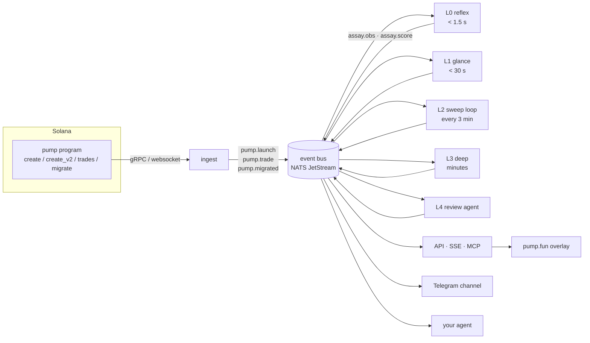

# Architecture

assay is built for the trenches: coins minutes old, scored while they still matter. Speed comes from a fixed rule: the
first answer is fast and rough, and every later loop makes it better. No layer waits for the one after it.

## The shape



Everything goes over the bus, in both directions. A layer reads events, writes **observations** and **score
snapshots** back to it, and moves on. The API, the Telegram channel, the overlay and anyone's agent are all just
consumers of the same bus.

## The event bus

**NATS JetStream** by default: a single binary, durable streams, consumers that resume where they stopped, and replay
from any point in time. Replay matters twice: a new layer can be backfilled by replaying a week of launches through
it, and an agent can rewind the tape to see what assay knew at the time. A Redis Streams adapter can come later.
The bus interface is small enough that swapping it out is a single file.

Topics, envelope and examples: [events.md](events.md).

## The layers

Each layer has a **latency budget**, a set of signals it's allowed to read, and a **decision** it must make before its
budget runs out: `drop` (cold: rechecked only on activity or a lookup), `watch` (into the sweep set), or `promote` (to
the next layer now).

| layer | budget | reads | decides |
|---|---|---|---|
| **L0 reflex** | p95 < 1.5 s after the create tx lands | the create tx itself, on-chain metadata, in-memory caches: creator lineage, funding parents, image hashes, ticker collisions, launch bundle | drop / watch / promote |
| **L1 glance** | < 30 s | metadata JSON (socials), one X profile read, website fetch + RDAP + CT log, Telegram count, mint-on-site, link shape | drop / watch / promote |
| **L2 sweep** | a loop, every 3 min (configurable) | every coin in the watch set that fits the window: holder growth + funding diversity (incremental), new mentions, X engagement deltas, trade-graph deltas | demote / hold / promote |
| **L3 deep** | minutes | follower sample, reply clustering, mindshare search, news + outlet class, full funding trace, wash analysis | flag / hold / promote to review |
| **L4 review** | minutes | the whole evidence bundle, as quoted data | `curated` or not, with a written note |

L0 never makes a network call it can't afford to lose. If the metadata JSON hasn't arrived within 800 ms, L0 decides on
the chain alone and L1 fills in the rest. A late answer from a layer is never thrown away; it updates the coin's
score whenever it lands.

### The sweep loop

The core of it, and the part that does the most work. Every window (default 3 minutes):

1. Take the watch set and rank it by **priority** = activity since the last pass (new holders, volume, new mentions,
   lookups) × staleness of the coin's last observations.
2. Work down the ranking until the **window budget** runs out. The budget is time, X reads and model tokens, all
   configured by whoever runs it.
3. Whatever doesn't fit rolls over. Staleness keeps rising, so a quiet coin works its way back up and nothing starves.
4. Publish the window's stats (`assay.sweep`): coins seen, coins skipped, reads spent, median age of the data. That
   tells you how big the budget needs to be.

More budget means more coins per window and fresher data on each one. That's the one setting that scales assay from
a laptop up to a fleet, and the reason spending more money buys more coverage.

### The review agent (L4)

The `curated` tier is decided by an agent reading the evidence, not by a person on a rota:

- It sees the evidence bundle as **quoted data** (the coin's own text is fenced and labelled as untrusted), and answers
  in a fixed schema: decision, note, which observations it relied on.
- It can only promote a coin whose deterministic gates already pass (no open flags, confidence ≥ 0.7 on every
  dimension). It can raise a flag. It can't clear one.
- The note is signed `agent:<model>@<prompt version>`, so a change of model or prompt shows up on every report it
  touches.
- Whoever runs the instance can override any decision. The override is a signed observation that stays on the record.

## Where it runs

| part | where |
|---|---|
| ingest, L0, L1 | one long-running process near a good RPC; hot caches in memory, warmed from Postgres at boot |
| L2, L3, L4 | workers that consume the bus; scale by adding consumers |
| bus | NATS JetStream (one node is fine to start) |
| store | Postgres: `observations` (append-only, partitioned by day), `scores`, `flags`, plus the shared caches |
| raw captures | any S3-compatible bucket, content-addressed |
| API | a stateless service over Postgres + the bus; cacheable at an edge |

The baseline is TypeScript: the language most agents read and change fastest. If the L0 hot path needs to go faster,
it's the one piece worth rewriting in Rust.

## Repo layout (planned)

```
packages/
  bus/          the bus interface + NATS adapter + in-memory adapter for tests
  ingest/       pump program listener, decoders for create / create_v2 / trade / migrate
  signals/      one module per signal: read → observation
  layers/       l0-reflex, l1-glance, l2-sweep, l3-deep, l4-review
  score/        observations → dimensions, flags, tiers
  store/        Postgres schema + migrations, capture bucket
  api/          REST + SSE + webhooks
  mcp/          the MCP server
  telegram/     the channel poster
  overlay/      the browser extension
config/
  weights.yaml  every weight, threshold and budget, in one file
.env.example    every key, supplied by whoever runs it
```

## Bring your own keys

assay ships with no keys and no hosted dependency. Whoever runs an instance supplies their own:

| key | for | required |
|---|---|---|
| `SOLANA_RPC_URL` | reads, history | yes |
| `SOLANA_GRPC_URL` / `SOLANA_WS_URL` | the launch stream | one of them |
| `X_BEARER_TOKEN` | X profile, timeline, followers, search (first-party X API) | for L1+ social signals |
| `MODEL_API_KEY` + `MODEL_*` | classification, extraction, the review agent | for L1+ text signals and L4 |
| `NEWS_API_KEY` | news search | for Coverage |
| `TELEGRAM_BOT_TOKEN` | channel counts, the calls channel | optional |
| `NEYNAR_API_KEY` | Farcaster | optional |

A missing key turns its signals off; it doesn't fail the run. The report says which signals were off
(`confidence` drops), so a run without X data can't pass itself off as one with it.
