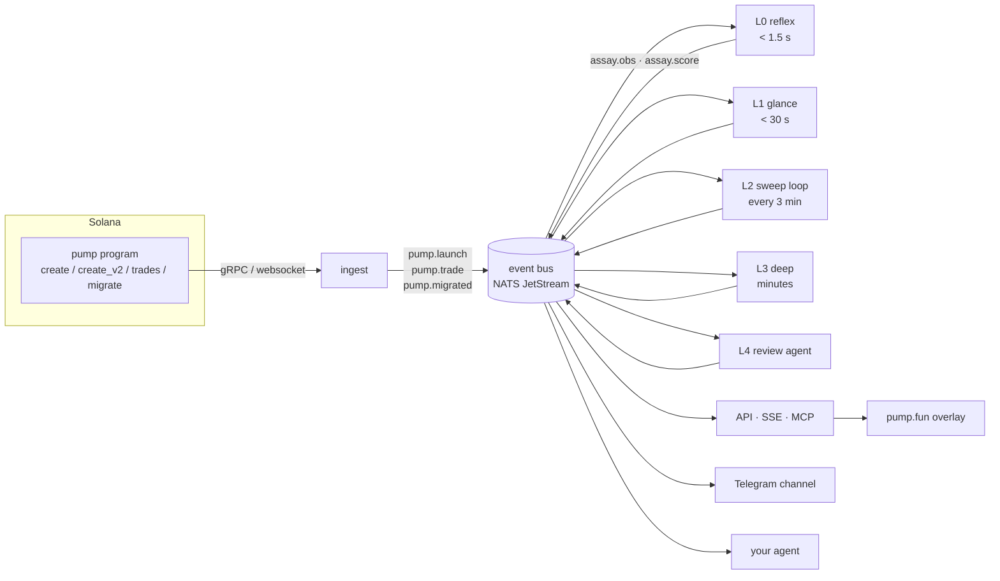

# Architecture

assay is built for the trenches: coins minutes old, scored while they still matter. Speed comes from a fixed rule: the
first answer is fast and rough, and every later loop makes it better. No layer waits for the one after it.

## The shape



Everything goes over the bus, in both directions. A layer reads events, writes **observations** and **score
snapshots** back to it, and moves on. The API, the Telegram channel, the overlay and anyone's agent are all just
consumers of the same bus.

## Speed

The rule on the hot path: **push, never poll.** Nothing between a launch landing and a pure-launch post waits on a
timer.

### Getting the launch

| path | how | when to use it |
|---|---|---|
| **Yellowstone gRPC** | a transaction subscription filtered to the pump program, at `processed` commitment, with `failed: false` (failed transactions are never ingested) | the default: the fastest standard way to see a transaction |
| **RPC websocket, logs** | `logsSubscribe` mentioning the pump program, at `processed`. pump.fun's create and trade events are emitted in the program logs, so they decode straight from the log lines, with **no `getTransaction` round trip** | no gRPC provider; also the independent second source |
| **RPC websocket, full transactions** | an enhanced `transactionSubscribe` where the provider offers one | when the logs aren't enough (balances, inner instructions) |
| **shreds** | a shred stream or your own validator | the last few hundred milliseconds, if they ever matter |

Two sources run at once and reconcile. A launch seen by only one is logged as a gap.

`processed` is fast and can be dropped by a fork. Every observation records the commitment it was made at; the tape
re-checks at `confirmed`, and a transaction that never confirms gets a retracting observation.

### Watching what matters after launch

| what | how |
|---|---|
| every trade on every coin | the same program subscription; the tape reads it |
| the bonding curve of each watched coin | `accountSubscribe` on the curve account: state on every change, nothing to parse |
| creator wallets, fee vaults, predator clusters | **RPC webhooks** (address-watching webhooks from the RPC provider): thousands of addresses without holding thousands of subscriptions, pushed within seconds. Used where a few seconds is fine: dev transfers, fee claims, a known cluster moving funds before it buys |

### Inside the process

- Ingest, decode, L0 and the tape run in **one process** with the caches in memory: no network hop and no database
  read before an L0 decision. The bus publish is local.
- L1's fetches run **in parallel** with tight timeouts: the metadata JSON is raced across several IPFS gateways (first
  answer wins), the image is fetched and hashed as it streams, RDAP and the site fetch go out at the same moment.
- Funding traces read the cached cluster index first; only an unknown wallet costs an RPC walk, and the walk is
  limited by `trace_hops`.
- The Telegram post goes out as soon as the pure checklist passes and `min_age` has elapsed.

### Latency targets (to be measured, not promised)

| step | target |
|---|---|
| launch transaction produced → seen (gRPC, `processed`) | under 0.5 s |
| decode + L0 decision | under 50 ms |
| early-buyer funding clusters (cached) | under 1 s |
| L1: metadata, image, links (parallel, raced) | 2–10 s |
| pure-launch post, from launch | `min_age` (30 s by default) once everything above has passed |

## The event bus

**NATS JetStream** by default: a single binary, durable streams, consumers that resume where they stopped, and replay
from any point in time. Replay matters twice: a new layer can be backfilled by replaying a week of launches through
it, and an agent can rewind the tape to see what assay knew at the time. A Redis Streams adapter can come later.
The bus interface is small enough that swapping it out is a single file.

Topics, envelope and examples: [events.md](events.md).

## The layers

Each layer has a **latency budget**, a set of signals it's allowed to read, and a **decision** it must make before its
budget runs out: `drop` (cold: rechecked only on activity or a lookup), `watch` (into the sweep set), or `promote` (to
the next layer now).

| layer | budget | reads | decides |
|---|---|---|---|
| **L0 reflex** | p95 < 1.5 s after the create tx lands | on-chain arguments only (launch config, quote, holder-reward and sharing settings), in-memory caches: creator lineage, funding clusters, ticker collisions (with homoglyphs), metadata URI/CID reuse, wallet classes of the first buyers. No network calls | drop / watch / promote |
| **L1 glance** | < 30 s, **only once the curve is alive** (≥ x SOL from ≥ y independent funding sources) | metadata JSON (socials), image hash + embedding + OCR, **at most one X user lookup**, website fetch + RDAP, Telegram count, mint-on-site, link shape, category | drop / watch / promote |
| **L2 sweep** | a loop, every 3 min (configurable): the cadence for **social reads** | every coin in the watch set that fits the window's budget: new mentions and callouts, X engagement deltas, Telegram growth, sibling versions | demote / hold / promote |
| **L3 deep** | minutes | follower sample, reply clustering, mindshare search (the only layer that reads followers or searches X), news + outlet class, full funding trace, wash analysis, reverse image search, callout event study | flag / hold / promote to review |
| **L4 review** | minutes; a coin realistically reaches it 30–90 min after launch | the whole evidence bundle, as quoted data | `curated` or not, with a written note |

### The tape

Alongside the layers, **the tape** processes every `pump.trade` as it arrives and keeps the Chain dimension current
within seconds: classed wallets entering (`predator_entered`), bundle and dev sells, fee claims, holder growth net of
program-held balances. It's the cheapest part of assay and the part trench traders need first, so it never waits for
a sweep. The sweep loop is for what costs money to read: social data.

**Decisions are taken for every enabled lens, not just the curator.** A coin is dropped only when no enabled lens
could want it. A heavy bundle sends a coin out of the curator's path and straight into the volatility lens's, so it
stays on the watch set. An instance that only runs the curator lens drops more and spends less.

L0 makes no network calls. Everything it needs is in the create transaction or already in memory; the metadata JSON
and the image are L1's. A late answer from a layer is never thrown away; it updates the coin's
score whenever it lands.

### The sweep loop

The core of it, and the part that does the most work. Every window (default 3 minutes):

1. Take the watch set and rank it by **priority** = activity since the last pass (new holders, volume, new mentions,
   lookups) × staleness of the coin's last observations.
2. Work down the ranking until the **window budget** runs out. The budget is time, X reads and model tokens, all
   configured by whoever runs it.
3. Whatever doesn't fit rolls over. Staleness keeps rising, so a quiet coin works its way back up and nothing starves.
4. Publish the window's stats (`assay.sweep`): coins seen, coins skipped, reads spent, median age of the data. That
   tells you how big the budget needs to be.

More budget means more coins per window and fresher data on each one. That's the one setting that scales assay from
a laptop up to a fleet, and the reason spending more money buys more coverage.

### The review agent (L4)

The `curated` tier is decided by an agent reading the evidence, not by a person on a rota:

- It sees the evidence bundle as **quoted data** (the coin's own text is fenced and labelled as untrusted), and answers
  in a fixed schema: decision, note, which observations it relied on.
- It can only promote a coin whose deterministic gates already pass (no open flags, confidence ≥ 0.7 on every
  dimension). It can raise a flag. It can't clear one.
- The note is signed `agent:<model>@<prompt version>`, so a change of model or prompt shows up on every report it
  touches.
- The exact model ID is part of that signature, and the deterministic gates are re-run before any note is trusted.
- Whoever runs the instance can override any decision. The override is a signed observation that stays on the record.

## The cross-coin indexes

What makes assay better every week is what it learns across coins, kept as shared indexes that every layer reads:

| index | built from | feeds |
|---|---|---|
| wallet reputation (wallet and funding cluster → class) | every pump.fun trade since launch, plus a backfill | L0 first buyers, `predator_entered`, `bundled`, Chain |
| creator lineage | every launch | `serial_creator`, `relaunch_of` |
| image index (hashes + embedding vectors) | every coin image | the vamp pipeline |
| author index (X user ID → quality, caller history, handle history) | every author assay has read | Mindshare, callouts, `influencer_involved` |
| follower classes | every follower sampled | Authenticity |
| outcome history (traits × outcomes, by window) | assay's own records | lenses only; never the curator lens |
| meta preference (pairing and fee config → what the market chose) | narrative clusters with several versions, daily | `config_vs_meta` |
| templates (site fingerprints, meme templates) | every crawl and image | Presence, vamp `template` class |

### Backfill before day one

L0 is only as good as its caches. Before an instance goes live, it backfills every historical pump.fun launch: creators,
tickers, metadata URIs, images (hashes and embeddings), and the funding clusters of early buyers. Empty caches make
lineage, copies and relaunches invisible on day one. Follower overlap can't be backfilled; until it has history, its
confidence says so.

## Lenses

Lenses ([lenses.md](lenses.md)) run after scoring: a small evaluator reads observations, traits and dimensions, applies
a lens file, and emits `assay.lens.<name>`. The built-in lenses run on the instance; a harness can run its own over the
stream with the same package.

## Where it runs

| part | where |
|---|---|
| ingest, L0, L1 | one long-running process near a good RPC; hot caches in memory, warmed from Postgres at boot |
| L2, L3, L4 | workers that consume the bus; scale by adding consumers |
| bus | NATS JetStream (one node is fine to start) |
| store | Postgres: `observations` (append-only, partitioned by day), `scores`, `flags`, plus the shared caches |
| raw captures | any S3-compatible bucket, content-addressed |
| API | a stateless service over Postgres + the bus; cacheable at an edge |

The baseline is TypeScript: the language most agents read and change fastest. If the L0 hot path needs to go faster,
it's the one piece worth rewriting in Rust.

## Repo layout

**Now** (the silent run, one process): `src/feeds.ts` (both feeds), `src/pump.ts` (decoding), `src/coin.ts` (positions,
funding, clusters), `src/pure.ts` (the checklist and the post), `src/tape.ts` (the watch and the thread),
`src/telegram.ts`, `src/store.ts` (SQLite), `src/run.ts`, `src/report.ts`. The bus is in-process until there's a second
process.

**Planned:**

```
packages/
  bus/          the bus interface + NATS adapter + in-memory adapter for tests
  ingest/       pump program listener, decoders for create / create_v2 / trade / migrate
  signals/      one module per signal: read → observation
  layers/       l0-reflex, l1-glance, l2-sweep, l3-deep, l4-review
  score/        observations → traits, dimensions, flags, tiers
  lens/         the lens evaluator (also published on its own, for harnesses)
  index/        wallet reputation, image index, author index, outcome history, meta preference
  store/        Postgres schema + migrations, capture bucket
  api/          REST + SSE + webhooks
  mcp/          the MCP server
  telegram/     the channel poster
  overlay/      the browser extension
config/
  weights.yaml  every weight, threshold and budget, in one file
  lenses/       curator, volatility, runner, clean-book, beta, original, pure
.env.example    every key, supplied by whoever runs it
```

## Bring your own keys

assay ships with no keys and no hosted dependency. Whoever runs an instance supplies their own:

| key | for | required |
|---|---|---|
| `SOLANA_RPC_URL` | reads, history | yes |
| `SOLANA_GRPC_URL` / `SOLANA_WS_URL` | the launch stream; run both for reconciliation | at least one; both recommended |
| `SOLANA_WEBHOOK_SECRET` | verifying the RPC provider's address webhooks (creator wallets, vaults, clusters) | optional |
| `X_BEARER_TOKEN` | X identity checks, the author index, X's capped share of Mindshare (first-party X API) | optional |
| `MODEL_API_KEY` + `MODEL_*` | classification, extraction, the review agent | for L1+ text signals and L4 |
| `NEWS_API_KEY` | news search | for Coverage |
| `TELEGRAM_BOT_TOKEN` | channel counts, the calls channel | optional |
| `NEYNAR_API_KEY` | Farcaster | optional |

A missing key turns its signals off; it doesn't fail the run. The report says which signals were off
(`confidence` drops), so a run without X data can't pass itself off as one with it.
