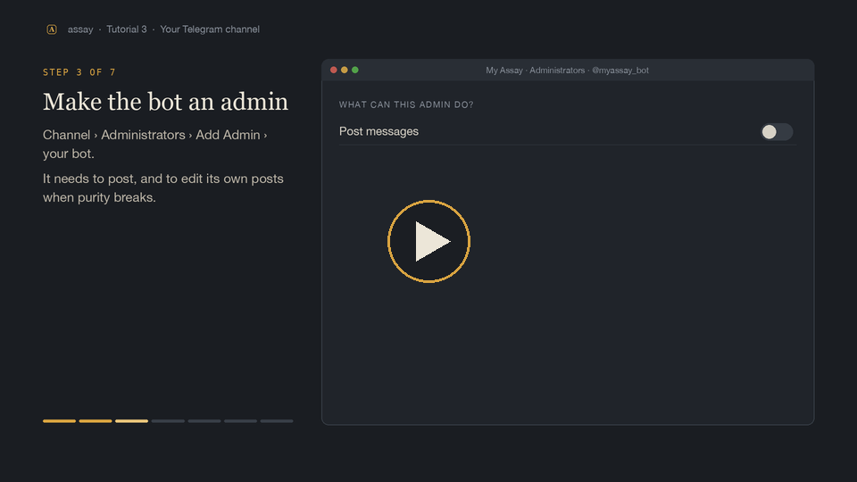

# Tutorial 3: your Telegram channel

[](https://assay.meex.work/tutorials/03-telegram.mp4)

*Watch the 1:18 walkthrough above, or follow the steps below. All four are at [assay.meex.work/tutorials](https://assay.meex.work/tutorials).*

**You'll end up with:** your own channel that posts pure launches, edits a post when purity breaks, and threads each
coin's history as comments underneath.

**Time:** about 15 minutes, all of it in the Telegram app.

---

## 1. Create a bot

1. In Telegram, open a chat with **@BotFather**.
2. Send `/newbot`, then a display name (e.g. "My Assay Bot"), then a username ending in `bot` (e.g. `myassay_bot`).
3. BotFather replies with a **token** like `123456789:AAH...`. Put it in `.env`:
   ```sh
   TELEGRAM_BOT_TOKEN=123456789:AAH...
   ```

Treat the token like a password: anyone with it can post as your bot.

## 2. Create the channel

1. **New Channel** → give it a name and description.
2. Make it **public** and choose a link, e.g. `t.me/my_assay`. The `@username` part (`@my_assay`) is what assay
   needs. A private channel works too, using its numeric id instead.
3. Set the channel in `config/assay.yaml`:
   ```yaml
   post:
     channel: "@my_assay"
   ```

## 3. Make the bot an admin of the channel

Channel → **Administrators** → **Add Admin** → search for your bot's username → turn on at least:

- **Post messages**
- **Edit messages of others** (assay edits its own posts when purity breaks)
- **Delete messages** (optional)

## 4. Add a discussion group (for the threads)

Each coin's history goes in the comments under its post. Telegram handles comments with a linked group:

1. Channel → **Discussion** → **Add a group** → create a new group (e.g. "My Assay Records").
2. In that group: **Administrators** → add your bot again, with **Pin messages** and **Ban users** on.
3. **Recommended:** make the group read-only, so the comments are only assay's. Group → **Permissions** → turn off
   everything for members except reactions. An open comment section under coin posts fills up quickly with other
   people's contract addresses and scam links.

No discussion group? assay still posts and edits; it just can't thread comments. The doctor tells you which.

## 5. Check it

```sh
npm run doctor
```

```
Telegram
  ✓ bot · @myassay_bot
  ✓ channel · My Assay
  ✓ bot is a channel admin · can post and edit
  ✓ no webhook (getUpdates works)
  ✓ bot is an admin of the discussion group · comments on
```

| `✗` you might see | why | fix |
|---|---|---|
| `bot token rejected` | the token is wrong or was revoked | copy it again from @BotFather (`/token`) |
| `channel @… not found` | wrong username, or the bot isn't in the channel | check `post.channel`; add the bot as admin |
| `bot can't post and edit in the channel` | missing admin rights | step 3 |
| `the bot has a webhook set` | the bot is used by something else with a webhook | assay reads updates by polling; use a separate bot, or remove the webhook |
| `bot isn't an admin of the discussion group` | step 4.2 skipped | add the bot as an admin in the group |

## 6. Go live

```sh
npm run silent
```

(no `--dry`). The first line now says `posting to @my_assay`.

**Want to practise first?** Point `post.channel` at a private test channel, run it for an hour, then switch to the
real one. Or keep `--dry` until you're happy with what it would post.

## The feedback buttons

Every post carries two buttons under "Disagree with a rule or finding? Let's chat". They point wherever you set in
`config/assay.yaml`:

```yaml
feedback:
  text: "Disagree with a rule or finding? Let's chat"
  x: https://x.com/your_account
  telegram: https://t.me/your_account
```

Leave a link empty to drop that button; leave both empty to drop the line.

## It worked if…

- The doctor shows five `✓` under Telegram.
- Within an hour of running, a post appears in your channel, and its comments show events ("Still pure at 5:00." or
  the reason it broke).

**Next:** [Tutorial 4: configuration](04-configuration.md).
