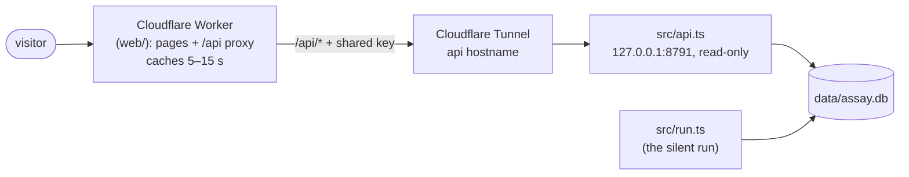

# Tutorial 6: the website

**You'll end up with:** your own copy of [assay.meex.work](https://assay.meex.work): the live numbers, every post,
the tape, and a page per coin, on your own domain.

**How it fits together:**



- **`src/api.ts`** is a small read-only server next to the silent run on your server. It only listens on
  `127.0.0.1`, so nothing on the internet can reach it directly, and it only answers requests carrying the shared key.
- **A Cloudflare Tunnel** gives it a public hostname without opening any port on your server.
- **A Cloudflare Worker** serves the pages and passes `/api/*` through to the tunnel with the key, caching each answer
  for a few seconds so your server never sees visitor traffic directly.

**You need:** a domain on Cloudflare (the free plan works) and [Tutorial 5](05-server.md) done.

---

## 1. Run the API on the server

Make a shared key and add it to `.env` on the server:

```sh
echo "ASSAY_API_KEY=$(openssl rand -hex 24)" >> ~/assay/.env
grep ASSAY_API_KEY ~/assay/.env       # you'll need this value in step 4
```

Install the service:

```sh
cd ~/assay
sed "s/YOUR_USER/$USER/g" deploy/assay-api.service | sudo tee /etc/systemd/system/assay-api.service
sudo systemctl daemon-reload
sudo systemctl enable --now assay-api
```

Check it answers (with the key) and refuses (without):

```sh
KEY=$(grep ASSAY_API_KEY ~/assay/.env | cut -d= -f2)
curl -s -H "x-assay-key: $KEY" http://127.0.0.1:8791/api/summary | head -c 200; echo
curl -s -o /dev/null -w "%{http_code}\n" http://127.0.0.1:8791/api/summary      # 401
```

## 2. Give it a hostname with a Cloudflare Tunnel

On the server:

```sh
# install cloudflared: https://developers.cloudflare.com/cloudflare-one/connections/connect-networks/downloads/
cloudflared tunnel login                       # opens a link; pick your domain
cloudflared tunnel create assay                # prints the tunnel's id
cloudflared tunnel route dns assay assay-api.example.com
```

Create `/etc/cloudflared/config.yml` (replace the id, the user and the hostname):

```yaml
tunnel: <TUNNEL-ID>
credentials-file: /home/YOUR_USER/.cloudflared/<TUNNEL-ID>.json
ingress:
  - hostname: assay-api.example.com
    service: http://localhost:8791
  - service: http_status:404
```

```sh
sudo cloudflared --config /etc/cloudflared/config.yml service install
sudo cloudflared tunnel --config /etc/cloudflared/config.yml ingress validate      # must print OK
```

> [!NOTE]
> Use a hostname **one level** under your domain (`assay-api.example.com`, not `api.assay.example.com`): Cloudflare's
> free certificate covers `*.example.com` only.

Already running a tunnel for something else? Add the `assay-api` hostname as another ingress rule above the final
`http_status:404` line, validate, and `sudo systemctl restart cloudflared`.

## 3. Point the site at your domain

On your own computer, in the repo, edit [`web/wrangler.toml`](../../web/wrangler.toml):

```toml
routes = [{ pattern = "assay.example.com", custom_domain = true }]

[vars]
SITE_ORIGIN = "https://assay.example.com"
API_ORIGIN = "https://assay-api.example.com"
```

Then change what's yours in the pages ([`web/public/`](../../web/public)): the channel link and feedback links in
`index.html`, `coin.html` and `how.html`, and the title if you've renamed it.

## 4. Deploy the Worker

```sh
cd web
npx wrangler login                             # once
npx wrangler deploy
npx wrangler secret put API_KEY                # paste the ASSAY_API_KEY value from step 1
```

`wrangler deploy` should end with `assay.example.com (custom domain)`. If it says **"No targets deployed"**, the
`routes` line ended up *below* `[assets]` in `wrangler.toml`. Every line after a `[section]` belongs to that section,
so `routes` must sit above it.

## 5. Check it

```sh
curl -s https://assay.example.com/api/summary | head -c 200; echo
curl -sI https://assay.example.com/ | grep -i content-security-policy
```

Then open the site: the live dot in the header turns green when the silent run has reported in the last couple of
minutes.

| symptom | cause | fix |
|---|---|---|
| `/api/...` returns 502 "the box is unreachable" | the tunnel or `assay-api` isn't running, or `API_ORIGIN` is wrong | `systemctl status cloudflared assay-api`; check the hostname |
| `/api/...` returns 401 | the Worker's `API_KEY` doesn't match `.env` on the server | `npx wrangler secret put API_KEY` again |
| pages load but no security headers | `run_worker_first = true` missing from `[assets]` | keep it: without it, Cloudflare serves files without running the Worker |
| the dot stays "feed paused" | the silent run isn't writing | `journalctl -u assay-silent -n 50` |

## What the site never shows

No prices, market caps or volumes, matching the channel. No coin images: they're arbitrary third-party uploads. A
coin's name and description are untrusted text and are always inserted as text, never as HTML.

**Next:** [Tutorial 7: operating it](07-operating.md).
